# Lab3 - CI/CD

Цель - настроить CI/CD для сервиса заметок из предыдущих лабораторных: проверять код,
собирать и сканировать Docker-образ, публиковать его и автоматически разворачивать приложение.

## Этапы работы:

### Подготовка

Для этой работы используем сервис из lab2. Он состоит из трех частей:

- frontend на NGINX - отдает статические файлы и проксирует запросы к API;
- backend на FastAPI - читает и сохраняет заметки;
- PostgreSQL - хранит данные в именованном томе.

Схема взаимодействия остается прежней:

```text
frontend (NGINX) -> backend (FastAPI) -> db (PostgreSQL)
```

Сначала настроим плохой пайплайн и разберем его недостатки. Затем исправим их в хорошем
пайплайне и проверим, что ошибки в коде и критические уязвимости блокируют деплой.
После успешного прохождения проверок образ должен публиковаться и запускаться автоматически.

Конфигурации GitHub Actions будем хранить в `.github/workflows/`, а материалы работы
и скриншоты - в `lab3/`.

---

### Плохой пайплайн

Для начала создадим `.github/workflows/lab3-bad.yml`. GitHub Actions будет запускать
его после push в ветку `lab3`, если изменился сам пайплайн или файлы `lab2/`.
Изменения только в отчете не запускают повторную сборку.

Пайплайн получает код репозитория, собирает образы backend и frontend, после чего
выводит список полученных образов. Команды сборки выполняются из `lab2/`, потому что
там находятся Dockerfile, зависимости и исходники приложения.

Для backend используем `Dockerfile_good` из предыдущей работы: в этом этапе
рассматриваем недостатки самого пайплайна, а не повторяем сравнение Dockerfile.

В конфигурации намеренно оставим несколько bad practices:

| Недостаток | К чему приводит | Как исправим |
|------------|----------------|--------------|
| `ubuntu-latest` | Окружение runner может измениться между прогонами | Укажем конкретную версию ОС runner |
| `actions/checkout@v4` | Тег action не фиксирует конкретный коммит | Закрепим action по полному SHA |
| Нет lint и тестов | Ошибки приложения не блокируют сборку | Добавим обязательную проверку кода перед сборкой |
| `docker build --no-cache` | Все слои пересобираются, включая установку зависимостей | Настроим сохранение и использование кеша между прогонами |
| Только тег `latest` | По тегу нельзя определить, из какого коммита собран образ | Добавим тег по SHA коммита |
| Нет сканирования образа | Образ с критическими уязвимостями может пройти пайплайн | Добавим Trivy и блокировку при CRITICAL |

`permissions: contents: read` разрешает пайплайну читать код репозитория.
Настоящие пароли и токены в YAML не добавляем.

На этом этапе образы остаются на временной машине runner: публикация, деплой и
проверка работающего сервиса еще не настроены. Зеленый результат такого пайплайна
будет означать только успешную сборку образов.

#### Проверка запуска

После коммита и push откроем вкладку **Actions** в репозитории и посмотрим первый
запуск **Lab3 - Bad pipeline** для коммита `31bca68` в ветке `lab3`.

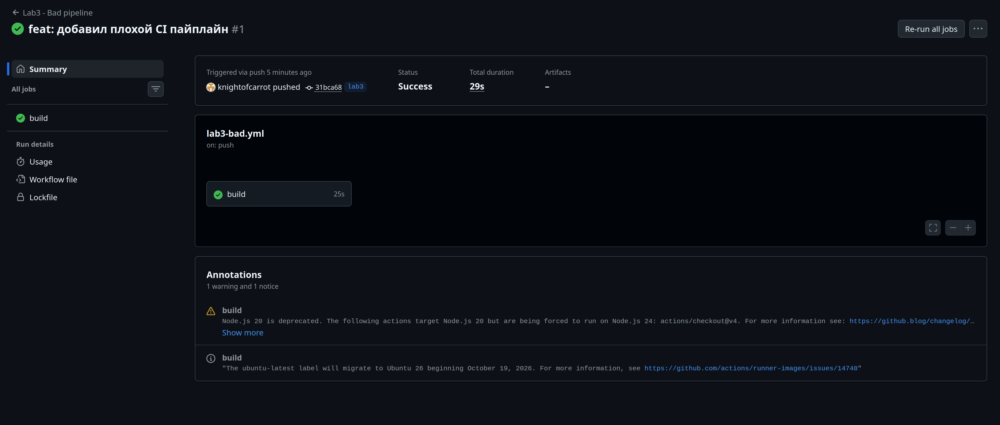

Видим статус **Success**. Общее время прогона составило **29 секунд**, а задача
`build` выполнялась **25 секунд**.

Теперь откроем задачу `build` и раскроем шаг `Show built images`:

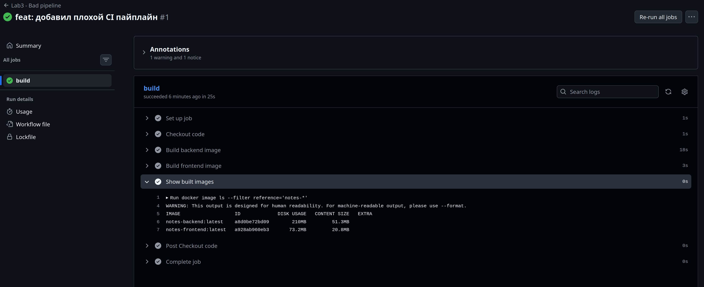

В списке есть оба образа: `notes-backend:latest` и `notes-frontend:latest`.
Сборка backend заняла **18 секунд**, frontend - **3 секунды**.

При этом зеленый статус подтверждает только то, что команды сборки завершились
успешно. Тесты и сканирование не запускались, поэтому ошибки в поведении приложения
и критические уязвимости такой пайплайн не проверяет. Контейнеры приложения тоже
не запускались: работоспособность сервиса после сборки пока не подтверждена.

На странице запуска также появились предупреждение об устаревшем Node.js 20,
используемом `actions/checkout@v4`, и уведомление о переходе `ubuntu-latest`
на Ubuntu 26. Они не прервали сборку, но показывают, почему в хорошем пайплайне
нужно обновить action и явно выбрать версию ОС runner.

---

### Проверка кода и тесты

Начнем исправлять плохие практики. Перед сборкой образов добавим проверку Python-кода
через Ruff и тесты API через pytest. Для HTTP-запросов к приложению используем
`TestClient` из FastAPI и библиотеку HTTPX.

Настройки проверок вынесем в `lab3/pyproject.toml`, а дополнительные зависимости -
в `lab3/requirements-dev.txt`. Файлы приложения в `lab2/` на этом этапе не меняем.

Ruff проверяет ошибки вроде неопределенных переменных и неиспользуемых импортов.
Для тестов поднимем отдельную PostgreSQL через `lab3/docker-compose.test.yml`:

- база называется `lab3_test` и доступна только через localhost на порту `55433`;
- пароль генерируется при каждом запуске, в конфигурации нет готового пароля;
- образ PostgreSQL закреплен по digest;
- данные находятся во временной файловой системе контейнера;
- после завершения проверки контейнер и его сеть удаляются.

Тесты отправляют запросы в приложение и работают с настоящей PostgreSQL.
Каждый тест использует отдельную транзакцию, изменения которой затем откатываются.
Вызов `commit()` внутри API работает через savepoint и не фиксирует внешнюю транзакцию
теста. Поэтому данные одного теста не мешают следующему.

| Проверка | Ожидаемый результат |
|----------|---------------------|
| `/health` | HTTP 200 и `status: ok` после запроса к БД |
| Список без заметок | HTTP 200 и пустой список |
| Создание и чтение заметки | HTTP 201, крайние пробелы удалены, запись доступна при новом запросе |
| Порядок заметок | Новые заметки идут первыми |
| Текст длиной 500 символов | Заметка успешно создается |
| Пустой текст | HTTP 422, запись не сохраняется |
| Только пробелы | HTTP 422, запись не сохраняется |
| Текст длиной 501 символ | HTTP 422, запись не сохраняется |
| Нет поля `text` | HTTP 422, запись не сохраняется |

#### Локальный запуск

Из корня проекта с активированным виртуальным окружением установим зависимости:

```bash
python -m pip install -r lab3/requirements-dev.txt
```

Затем запустим скрипт проверок. Для него нужен работающий Docker и доступ текущего
пользователя к Docker daemon:

```bash
bash lab3/check.sh
```

Скрипт сначала запускает Ruff, затем поднимает тестовую БД, ждет ее готовности
и выполняет pytest. При завершении, в том числе с ошибкой, выполняется очистка.

При локальном запуске получили:

```text
Проверка кода Ruff:
All checks passed!
...
9 passed, 1 warning in 0.47s
```

Предупреждение связано с использованием устаревшего имени `BlockingPortal`
в установленной связке Starlette и AnyIO. Оно не прервало тесты, все девять
проверок завершились успешно.

#### Проверки в GitHub Actions

Создадим `.github/workflows/lab3-good.yml` и разделим работу на две задачи:

```text
check (Ruff + pytest + тестовая PostgreSQL) -> build (backend + frontend)
```

Зависимость `needs: check` означает, что сборка образов разрешена только после
успешного прохождения проверок. GitHub Actions вызывает тот же `lab3/check.sh`,
который использовали локально.

В отличие от плохого пайплайна, здесь уже используем:

- явно выбранный runner `ubuntu-24.04` и Python `3.12.7`;
- actions, закрепленные по полному SHA коммита;
- кеш pip с ключом, зависящим от файлов зависимостей;
- тег Docker-образа по SHA коммита вместо единственного `latest`;
- ограничение времени выполнения задач.

Сохранение Docker-кеша между прогонами, сканирование, публикацию и деплой добавим
следующими этапами. Пока хороший пайплайн содержит только проверку и сборку.

При повторной локальной проверке также получили успешный Ruff и все девять
пройденных тестов. После тестов контейнер PostgreSQL и его сеть удалились:

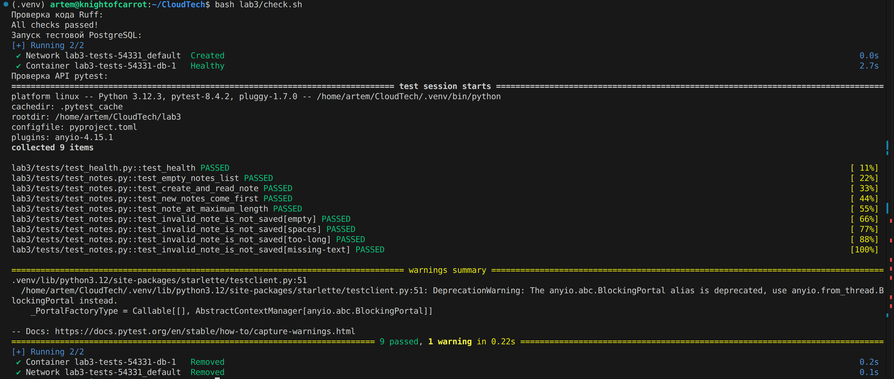

Теперь посмотрим первый запуск **Lab3 - Good pipeline** на GitHub для коммита
`cf19dad` в ветке `lab3`:

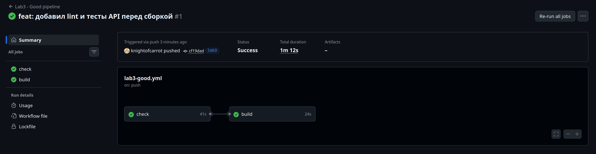

Обе задачи завершились успешно: `check` за **41 секунду**, `build` за **24 секунды**.
Общее время прогона составило **1 минуту 12 секунд**.

Откроем шаг `Lint and test` внутри задачи `check`:

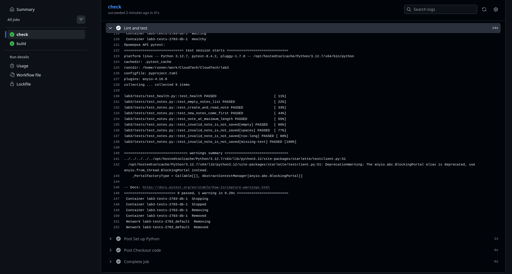

Видим **9 passed, 1 warning in 0.29s**. Тестовая PostgreSQL была готова перед
запросами, а после проверки контейнер и сеть удалились. Предупреждение Starlette
об устаревшем имени `BlockingPortal` не прервало выполнение.

Таким образом, проверки работают и локально, и на runner GitHub Actions.
После успешных проверок на runner выполнилась сборка образов. Блокировку сборки
при падающем тесте проверим отдельным прогоном с намеренной ошибкой.

---

### Блокировка сборки при падающем тесте

Проверим, что задача `check` действительно останавливает пайплайн. Для этого
в отдельном коммите намеренно изменим ожидаемый HTTP-статус в `test_health`:

```python
# Было: ожидаем нормальный ответ работающего сервиса.
assert response.status_code == 200

# Для демонстрации: намеренно ожидаем неправильный статус.
assert response.status_code == 503
```

Сам эндпоинт `/health` не меняем: при доступной БД он по-прежнему возвращает
HTTP 200. Поэтому тест должен упасть с сообщением `assert 200 == 503`.

После push проверим, что задача `check` завершилась с ошибкой, а `build` получила
статус `Skipped`, поскольку зависит от успешной проверки через `needs: check`.
На этом этапе деплой еще не настроен: этот прогон проверяет блокировку сборки.
Блокировку всей цепочки до деплоя продемонстрируем после добавления остальных стадий.

После push коммита `3f22377` получили красный прогон:

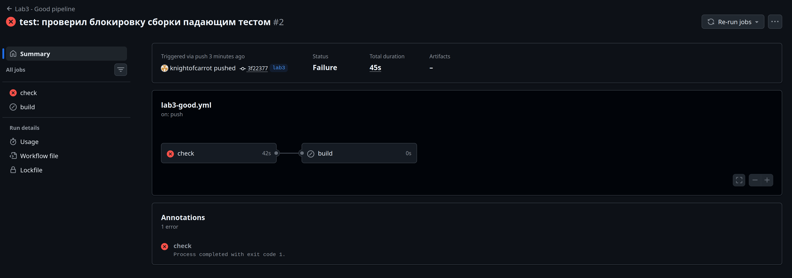

Задача `check` завершилась с ошибкой за **42 секунды**, а `build` была пропущена.
Общее время прогона составило **45 секунд**. Образы в этом прогоне не собирались.

Откроем ошибку в шаге `Lint and test`:

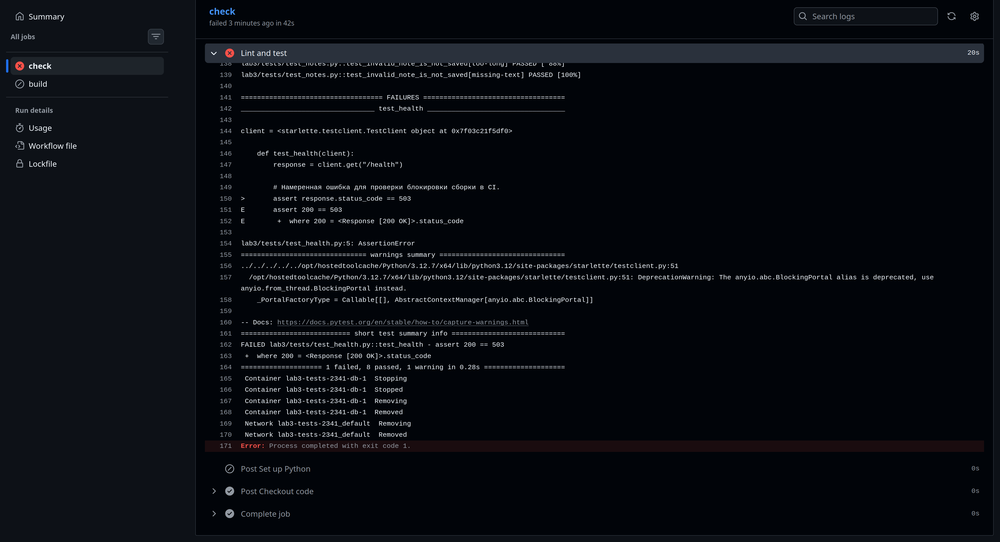

В логе видим ожидаемую ошибку `assert 200 == 503` и итог:

```text
1 failed, 8 passed, 1 warning in 0.28s
Error: Process completed with exit code 1.
```

Несмотря на ошибку, скрипт удалил тестовый контейнер и сеть. Таким образом,
зависимость `needs: check` работает: ошибка теста остановила дальнейшую сборку.

#### Исправление теста

Теперь отдельным коммитом вернем в `test_health` правильное ожидание HTTP 200
и уберем комментарий о намеренной ошибке. Остальные проверки оставим без изменений.
После push коммита `397fa81` проверим повторный прогон:

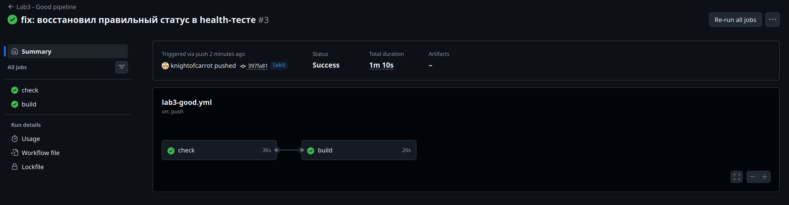

Обе задачи снова зеленые: `check` завершилась за **36 секунд**, а `build` -
за **26 секунд**. Общее время прогона составило **1 минуту 10 секунд**.

Получили последовательность: неправильное ожидание в тесте привело к красному
`check` и пропуску сборки, а после исправления проверка и сборка снова прошли.
Падающий тест остался в истории отдельного коммита, в текущей версии ожидаем HTTP 200.

---

### Сканирование Docker-образов и security-gate

Теперь добавим Trivy после сборки. Для демонстрации исходных уязвимостей создадим
`lab3/backend/Dockerfile` на полном образе `python:3.12.7`, закрепленном по digest.
Приложение, зависимости, multi-stage build и запуск обычным пользователем сохраним.
Исходники берем из `lab2/`; файлы прошлой лабораторной не меняем.
Для frontend пока используем существующий `lab2/nginx/Dockerfile`.

Установку сканера вынесем в `lab3/install-trivy.sh`: версия Trivy **0.75.0**
и SHA256 архива зафиксированы. Перед распаковкой проверяется контрольная сумма.

Скрипт `lab3/scan.sh` сначала сканирует оба собранных образа и сохраняет полные
JSON-отчеты, таблицы HIGH/CRITICAL, версию сканера и метаданные базы CVE.
Затем выводит краткую сводку и проверяет каждый образ командой вида:

```bash
trivy image --image-src docker --scanners vuln --severity CRITICAL --exit-code 1 IMAGE
```

Параметр `--exit-code 1` заставляет Trivy завершиться с ошибкой при обнаружении
CRITICAL. Уязвимости без готового исправления не исключаем. HIGH показываем
в отчетах, но они сами по себе не блокируют пайплайн.

#### Исходные результаты локального сканирования

| Образ | HIGH | CRITICAL |
|-------|-----:|---------:|
| Backend на полном Python 3.12.7 | 2518 | 228 |
| Frontend на NGINX 1.27.4 Alpine | 65 | 4 |

Здесь считаем находки по установленным пакетам, а не уникальные CVE. Для backend
получилось 39 уникальных CRITICAL CVE, для frontend - 3. Один CVE может относиться
сразу к нескольким пакетам, например к `libcrypto3` и `libssl3`.

Сканирование выполнили 5 ноября 2026 года. Сводка, идентификаторы образов, дата
базы CVE и примеры пакетов сохранены в [исходных результатах](security/before-summary.md).
Полные локальные отчеты находятся в игнорируемой папке `lab3/trivy-reports/`.

В backend среди CRITICAL найдены уязвимости ImageMagick, который входит в полный
базовый образ и не нужен сервису заметок. Во frontend найдены CRITICAL в
`brotli-libs`, `libcrypto3`, `libssl3` и `libxml2`. После получения красного прогона
обновим образы и повторим сканирование, сохранив результаты до и после.

#### Подключение к пайплайну

В задаче `build` после сборки добавим шаг **Scan images and block CRITICAL**.
Перед ним устанавливается Trivy. После него шаг **Upload Trivy reports**
с условием `always()` сохраняет отчеты как артефакт даже при срабатывании gate.
Сводка HIGH/CRITICAL также появляется в Summary запуска.

Сборку переведем на Buildx и добавим кеш слоев в GitHub Actions. Для backend
и frontend используем отдельные области кеша. Теги образов по-прежнему содержат
SHA коммита, публикации и деплоя на этом этапе еще нет.

После push коммита `78b532f` получили ожидаемый красный прогон:

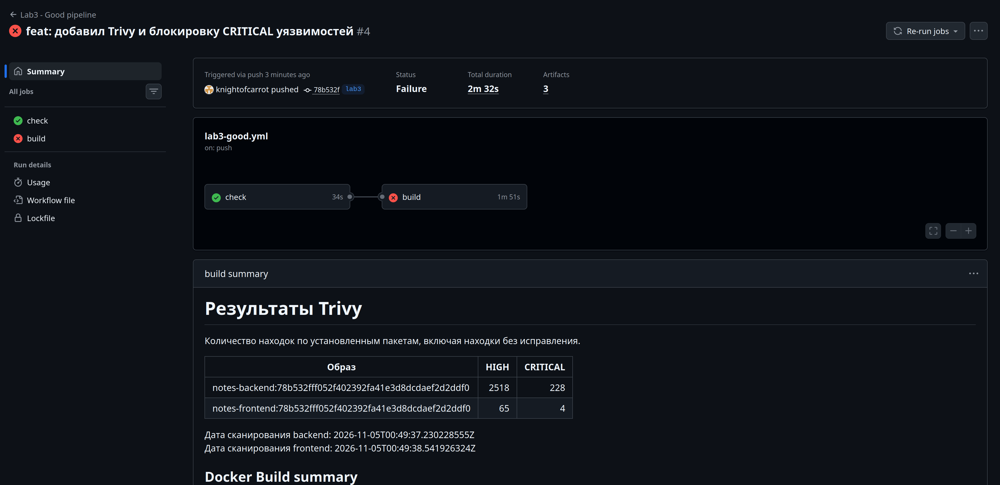

Задача `check` успешна, а задача `build` завершилась с ошибкой на шаге
**Scan images and block CRITICAL**. Общий прогон занял **2 минуты 32 секунды**.
Сводка GitHub совпала с локальным результатом: backend - 2518 HIGH и 228 CRITICAL,
frontend - 65 HIGH и 4 CRITICAL.

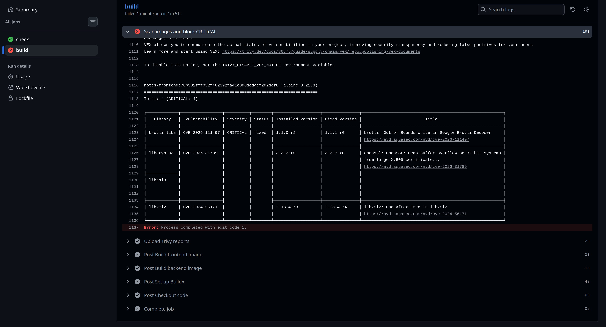

В логе видны четыре CRITICAL во frontend и завершение с кодом 1. Шаг
**Upload Trivy reports** успешен, несмотря на ошибку сканирования: отчеты
сохранены как артефакт. Таким образом, security-gate действительно работает.

#### Исправление образов

Заменим полный Python 3.12.7 на **Python 3.12.16 Slim Trixie**. В облегченном
образе нет ImageMagick и множества других пакетов, которые не нужны приложению.
В финальном слое также выполним `apt-get update` и `apt-get upgrade -y`.
Multi-stage build, отдельного пользователя и healthcheck сохраним. Для healthcheck
используется стандартная библиотека Python, отдельная установка curl не требуется.

Для frontend создадим `lab3/nginx/Dockerfile` на **NGINX 1.30.6 Alpine** и выполним
`apk upgrade --no-cache`. В частности, при сборке обновились `brotli-libs`,
`libcurl`, `curl` и `libexpat`. Образы Python и NGINX закреплены по digest.
Конфиг NGINX и исходники приложения продолжаем брать из `lab2/`.
В CI также обновим Python до 3.12.16, чтобы версия совпадала с backend-образом.

Повторим локальное сканирование Trivy 0.75.0. Метаданные подтверждают, что база CVE
до и после имеет одинаковый `UpdatedAt`:

| Образ | HIGH до | HIGH после | CRITICAL до | CRITICAL после |
|-------|--------:|-----------:|------------:|---------------:|
| Backend | 2518 | 48 | 228 | 0 |
| Frontend | 65 | 0 | 4 | 0 |

Security-gate завершился успешно: CRITICAL не найдены в обоих образах.
[Сводка после исправления](security/after-summary.md) содержит дату скана,
идентификаторы образов и сведения об оставшихся HIGH.

В backend осталось 48 HIGH:

- 45 находок в системных пакетах Debian: в использованной базе Trivy для них
  не указана исправленная версия, в том числе для пакетов util-linux и ncurses;
- 3 находки в Starlette 0.47.3: исправления указаны в 0.49.1, 1.1.0 и 1.3.1.
  Сохраненный FastAPI 0.116.1 требует Starlette ниже 0.48.0, поэтому простая
  принудительная установка этих версий нарушит ограничения зависимостей.
  Обновление связки FastAPI/Starlette на этом этапе не выполняли.

Эти находки не исключаем из отчета. Порог gate остается CRITICAL, как требует
задание; успешный gate не означает отсутствия любых известных уязвимостей.

Также проверим работоспособность исправленных образов. В отдельном временном
Compose-проекте поднимем PostgreSQL, backend и frontend, дождемся healthcheck
и отправим запросы через NGINX. Получили:

```text
Frontend: HTTP 200
NGINX healthcheck: HTTP 200
POST /api/notes: HTTP 201
GET /api/notes: HTTP 200, запись сохранена в PostgreSQL
```

После проверки временные контейнеры и сеть удалены. Это локальная проверка
исправленных образов, автоматический деплой пока не настроен.

После push коммита `01267b4` получили зеленый прогон:

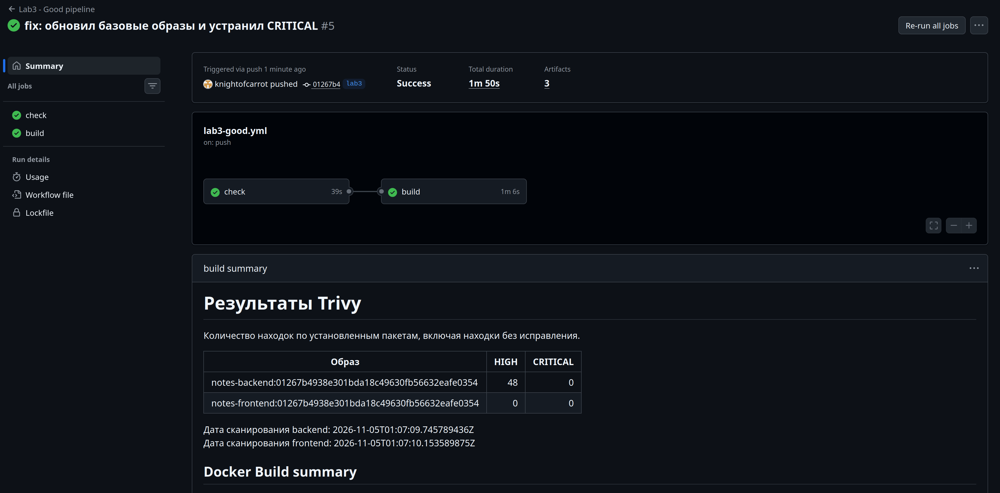

Проверки заняли **39 секунд**, задача сборки и сканирования - **1 минуту 6 секунд**.
Общее время прогона составило **1 минуту 50 секунд**. Сводка GitHub совпала
с локальным результатом: backend - 48 HIGH и 0 CRITICAL, frontend - 0 HIGH и 0 CRITICAL.

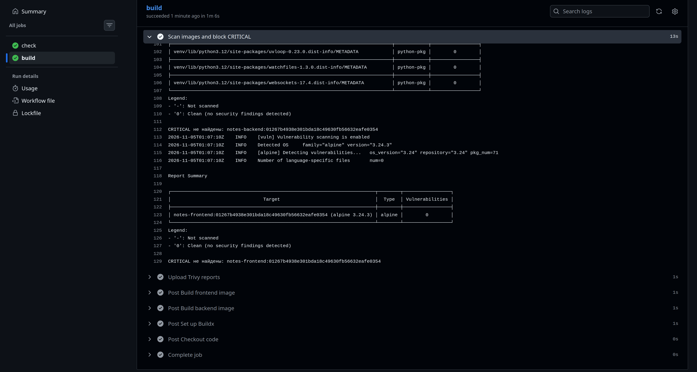

В шаге **Scan images and block CRITICAL** видим сообщения «CRITICAL не найдены»
для обоих образов. Отчеты также успешно сохранены. Порог проверки не меняли:
красный исходный прогон и зеленый прогон после обновления образов подтверждают
работу security-gate.

---

### Публикация образов в GHCR

До этого момента образы оставались на временной машине runner. Теперь после
успешного Trivy отправим их в GitHub Container Registry (GHCR), чтобы машина
деплоя могла скачать готовые проверенные образы.

Для авторизации используем встроенный `GITHUB_TOKEN`, который GitHub создает
для запуска workflow. Право `packages: write` выдаем только задаче `build`.
В YAML хранится ссылка на секрет, а не значение токена. Дополнительный PAT
для публикации не создаем.

Шаг **Log in to GHCR** использует официальный `docker/login-action`, закрепленный
по полному SHA. Он расположен после сканирования: если проверка кода, сборка или
Trivy завершатся с ошибкой, авторизация и публикация не выполнятся.

Имена образов формируются из имени репозитория в нижнем регистре:

```text
ghcr.io/denisonya/cloudtech-backend:SHA_КОММИТА
ghcr.io/denisonya/cloudtech-frontend:SHA_КОММИТА
```

Метка `org.opencontainers.image.source` связывает образы с исходным репозиторием,
а `org.opencontainers.image.revision` содержит SHA коммита. Метки задаются при
сборке до сканирования.

Публикацию вынесем в `lab3/publish.sh`. Скрипт выполняет следующие действия:

1. Получает ID локального образа, уже прошедшего Trivy.
2. Добавляет ему тег GHCR и выполняет `docker push`, без повторной сборки.
3. Скачивает образ из GHCR через `docker pull` и проверяет совпадение ID.
4. Сохраняет ссылки с digest в `lab3/release/images.env`.

Ссылки с digest указывают точное содержимое образов. На этапе деплоя будем
использовать их, чтобы запустить проверенную версию. Файл не содержит паролей
или токенов и сохраняется артефактом **release-SHA**. В Summary также появляется
раздел **Публикация в GHCR** со ссылками на оба образа.

Доступ к новым пакетам может потребовать авторизации: публичный репозиторий
сам по себе не гарантирует анонимное скачивание контейнеров. Видимость пакетов
и доступ машины деплоя проверим отдельно перед настройкой деплоя.

После push коммита `3c1fe55` получили успешную публикацию:

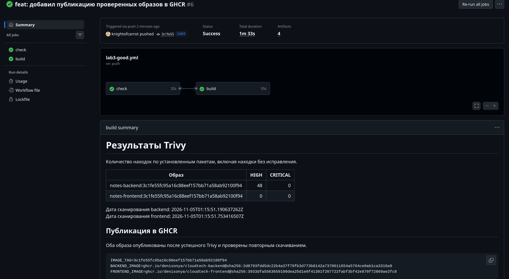

Общее время прогона составило **1 минуту 33 секунды**: задача `check` заняла
**32 секунды**, задача `build` - **55 секунд**. В Summary появились ссылки
с digest для обоих опубликованных образов. Trivy по-прежнему показывает
0 CRITICAL в backend и frontend.

Откроем шаг **Publish scanned images**:

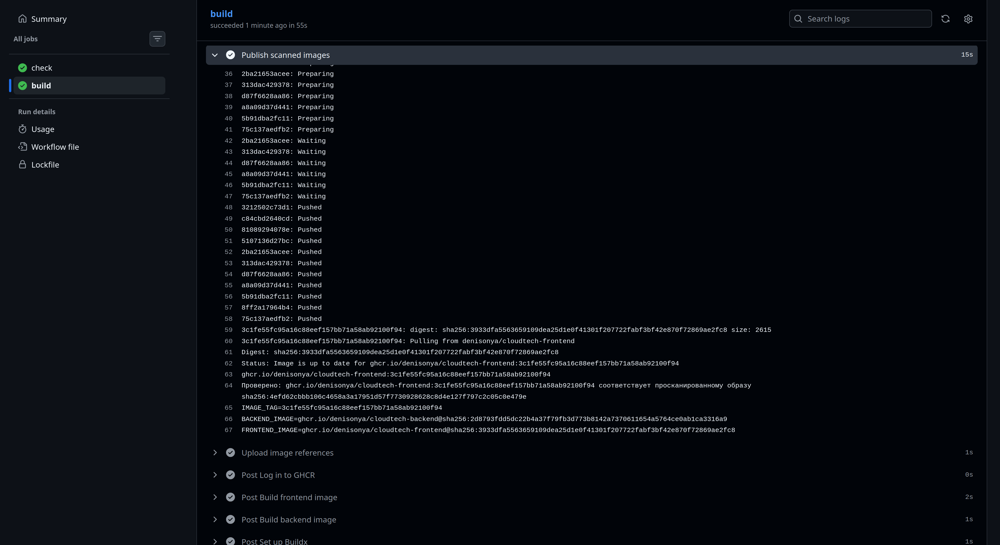

Шаг завершился успешно за **15 секунд**. В логе видны загрузка слоев, digest,
повторное скачивание из GHCR и подтверждение совпадения ID с просканированным
образом. Шаг **Upload image references** также успешен: ссылки для будущего
деплоя сохранены артефактом **release-SHA**.

Таким образом, пайплайн не только собирает и сканирует образы, но и публикует
проверенный результат в реестр. Запуск контейнеров на машине деплоя настроим
следующим этапом.

---

### Подготовка автоматического деплоя

Для запуска приложения на локальной машине подготовим отдельную задачу `deploy`.
Она зависит от успешной задачи `build`, в которой выполняются сборка, Trivy
и публикация. Задача предназначена для self-hosted runner с меткой `lab3-deploy`.
Порядок работы получается следующим:

```text
check -> build + Trivy + push -> deploy -> curl
```

Настройку runner описали в [инструкции подключения](runner.md). Он получает только
задачу деплоя; ресурсоемкие сборки и сканирование выполняются на GitHub-hosted runner.

Создадим `lab3/docker-compose.deploy.yml`. В нем нет секции `build`: backend
и frontend скачиваются из GHCR по digest из артефакта текущего прогона.
PostgreSQL использует именованный том. Сохраняем две сети, healthcheck,
зависимости `service_healthy`, restart и лимиты CPU/RAM.
Frontend публикуется на `127.0.0.1:8083`.

Скрипт `lab3/deploy.sh` проверяет формат ссылок на образы, сохраняет конфигурацию
релиза вне checkout runner, выполняет `docker compose pull` и
`docker compose up -d --no-build --pull never --wait`. Случайный пароль БД
создается только при первом запуске и сохраняется в локальном `.env` с правами 600.
Повторный деплой использует тот же пароль и том PostgreSQL.

Конфигурация находится в `~/.local/share/cloudtech-lab3/`. Внутри `releases/`
сохраняются Compose-файл и ссылки на образы каждого релиза. Файлы `current-release`
и `previous-release` содержат SHA текущей и предыдущей версий. Сам откат пока
не реализован. Параллельный деплой ограничен как задачей Actions, так и `flock`
в локальном скрипте.

Задача скачивает артефакт **release-SHA**, авторизуется в GHCR встроенным
`GITHUB_TOKEN` с правом `packages: read` и запускает деплой. После него отдельный
шаг **Check live service** вызывает `lab3/smoke.sh`: curl проверяет главную страницу,
NGINX `/healthz` и `/api/notes`. Последний запрос проверяет всю цепочку до БД.

#### Локальная проверка подготовки

Проверили Compose деплоя на локальных исправленных образах в отдельном временном
проекте с новым тестовым томом. Все три контейнера перешли в состояние healthy.
Скрипт `smoke.sh` получил HTTP 200 для главной страницы, `/healthz` и `/api/notes`.
После проверки временные контейнеры, сети и тестовый том удалили.

Это проверка Compose и curl-скрипта, а не подтверждение автоматического деплоя
из GitHub. Скриншоты реального деплоя и вывода финального curl добавим после
успешного выполнения задачи `deploy`.

#### Регистрация runner

Владелец репозитория предоставил временный токен регистрации. Установили runner
в `~/actions-runner-lab3`, вне репозитория, и зарегистрировали под именем
`lab3-local` с меткой `lab3-deploy`. После запуска `./run.sh` получили
`Connected to GitHub` и `Listening for Jobs`.

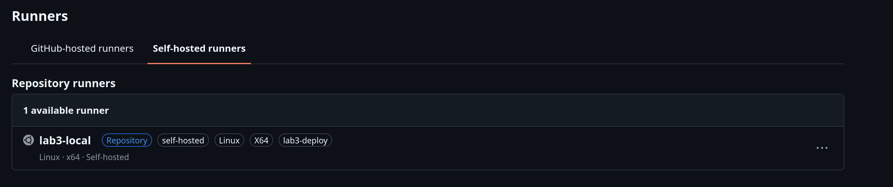

В GitHub runner отображается с метками `self-hosted`, `Linux`, `X64`
и `lab3-deploy`, соответствующими задаче деплоя.

#### Автоматический деплой и проверка сервиса

Первый запуск выявил ошибку в YAML: контекст `runner.temp` недоступен
в `env` на уровне задачи. Перенесли создание временного каталога авторизации
Docker в отдельный шаг через `RUNNER_TEMP` и `GITHUB_ENV`.

После исправления прогон **№8**, коммит `6ac7f17` в ветке `lab3`,
завершился успешно за **2 минуты 42 секунды**:

- `check` — 27 секунд;
- `build` со сканированием и публикацией — 1 минута 5 секунд;
- `deploy` — 1 минута 3 секунды.

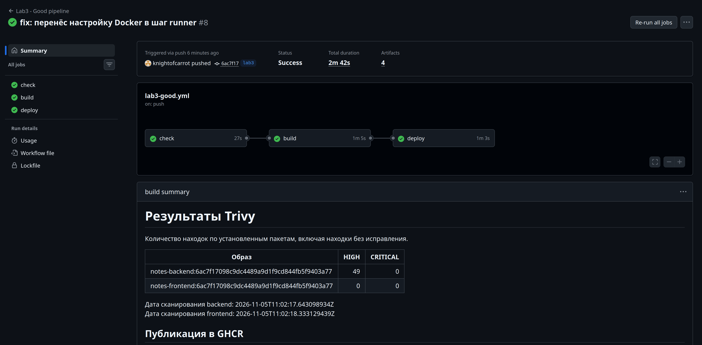

В этом прогоне Trivy обнаружил у backend 49 HIGH и 0 CRITICAL,
у frontend — 0 HIGH и 0 CRITICAL. Количество HIGH отличается от предыдущего
сканирования; результаты каждого прогона сохраняются отдельно. Условие
блокировки CRITICAL выполнено для обоих образов.

Self-hosted runner скачал ссылки из артефакта текущего прогона и развернул
образы из GHCR по digest. Шаг `Deploy scanned images` занял 41 секунду.
Контейнеры `lab3-db-1`, `lab3-backend-1` и `lab3-frontend-1` перешли
в состояние `healthy`.

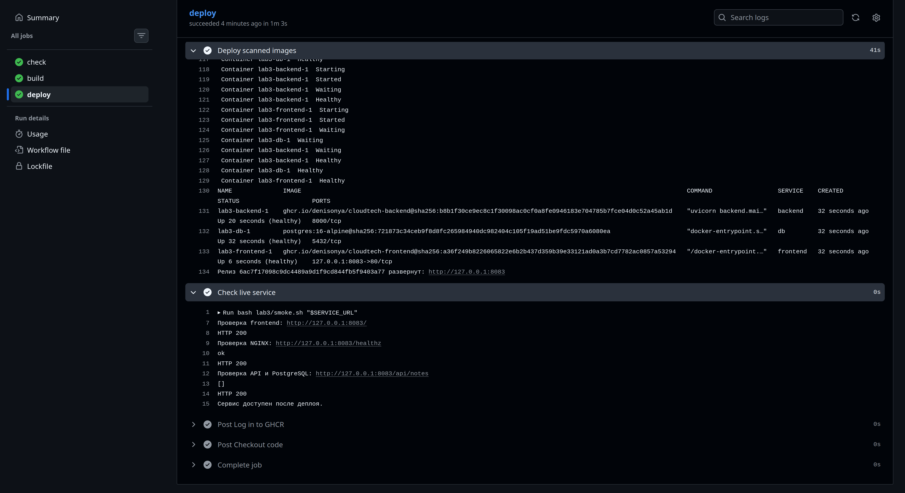

Шаг `Check live service` подтвердил HTTP 200 для `/`, `/healthz` и `/api/notes`.
API вернул пустой список `[]`, то есть запрос прошел через NGINX и backend
до PostgreSQL. Повторная локальная проверка `bash lab3/smoke.sh http://127.0.0.1:8083`
также завершилась успешно.

Адрес `http://127.0.0.1:8083` относится к машине деплоя — локальному компьютеру,
на котором работает runner. Порт frontend привязан к loopback; сервис доступен
с этого компьютера. Таким образом, подтверждена вся цепочка от push
до запуска приложения и проверки HTTP.

### Блокировка деплоя при ошибке теста

После подключения деплоя повторили демонстрацию с неправильным ожиданием
`503` вместо `200` в `test_health`. Коммит `5541f83` запустил прогон **№9**.
Проверка завершилась за 26 секунд: задача `check` упала, а `build` и `deploy`
получили статус `skipped`.

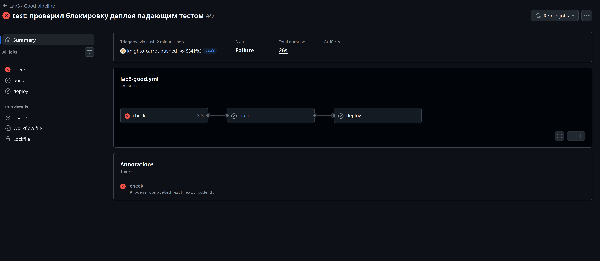

В логе видна конкретная причина: `assert 200 == 503`.
Результат pytest — **1 failed, 8 passed**. Приложение отвечало правильно;
ошибка была намеренно внесена в ожидание теста.

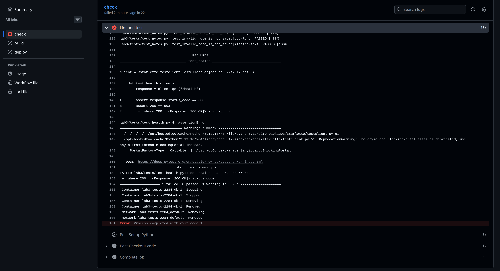

Проверили состояние машины деплоя: текущим остался релиз `6ac7f17`,
ID всех трех контейнеров не изменились. Повторный запуск `smoke.sh` получил
HTTP 200 для главной страницы, `/healthz` и `/api/notes`. Ошибочный коммит
не заменил работающую версию приложения.

Вернули правильное ожидание `200` отдельным коммитом `4cd74c9`.

Прогон [№10](https://github.com/Denisonya/CloudTech/actions/runs/42017462109)
завершился успешно за **2 минуты 36 секунд**: `check` — 32 секунды,
`build` — 1 минута 10 секунд, `deploy` — 34 секунды.
На машине деплоя текущим стал релиз `4cd74c9`, backend и frontend
обновились и находятся в состоянии `healthy`. Контейнер PostgreSQL
продолжил работать. Повторный curl подтвердил HTTP 200 на всех трех адресах.

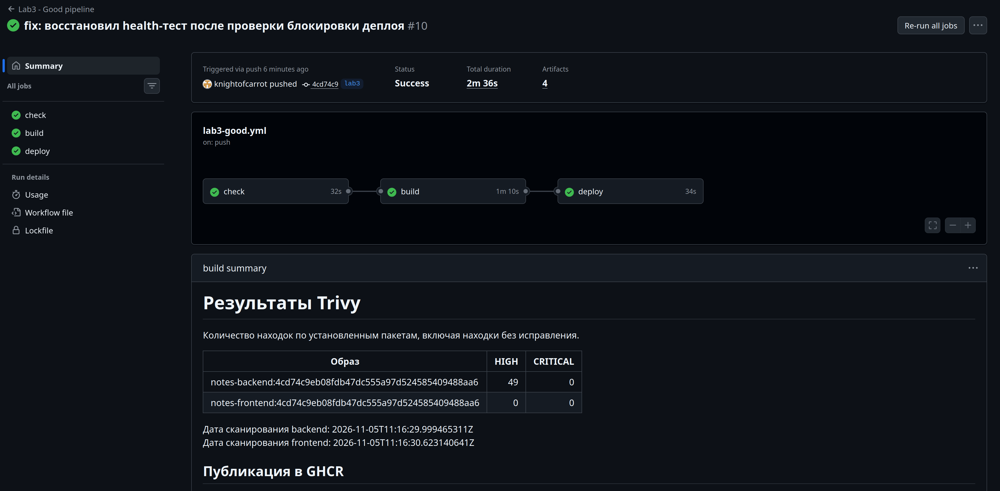

### Материал из задания

В статье [«Как рождаются *Ops'ы»](https://habr.com/ru/articles/689234/)
история Васи показывает, как инфраструктура обрастает инструментами
и почему разрозненные ручные действия трудно повторить на новом окружении.
Для этой работы полезен вывод: конфигурацию и последовательность выпуска
нужно хранить в Git, а результат проверять на работающем сервисе.

### Выводы

Настроили два пайплайна для одного приложения. Плохой вариант показывает
только успешную сборку; хороший проверяет код и тесты, сканирует образы,
публикует их в GHCR и разворачивает на локальной машине через self-hosted runner.

| Проверка | Подтвержденный результат |
|----------|-------------------------|
| Ошибка теста | Красный `check`, сборка и деплой пропущены; работающий релиз сохраняется |
| CRITICAL в образе | Trivy завершает шаг с ошибкой и блокирует публикацию |
| Исправление образов | Backend: CRITICAL 228 → 0, HIGH 2518 → 48; frontend: CRITICAL 4 → 0, HIGH 65 → 0 в сравнении на одной базе CVE |
| Успешный выпуск | Образы после сканирования опубликованы в GHCR и развернуты по digest |
| Работа приложения | Три healthy-контейнера, финальный curl возвращает HTTP 200 |

Кеши сокращают повторную сборку. Версии actions закреплены по SHA,
образы выпуска связаны с SHA коммита, для деплоя используются digest.
Авторизация в GHCR выполняется через `GITHUB_TOKEN`; пароль PostgreSQL
создается на машине деплоя и сохраняется вне репозитория.

Оставшиеся HIGH-уязвимости описаны в разделе сканирования. Условие блокировки
в этой работе — CRITICAL. Дополнительный откат версии со звездочкой
не реализован: наличие предыдущих ссылок на образы само по себе
не является демонстрацией rollback.
